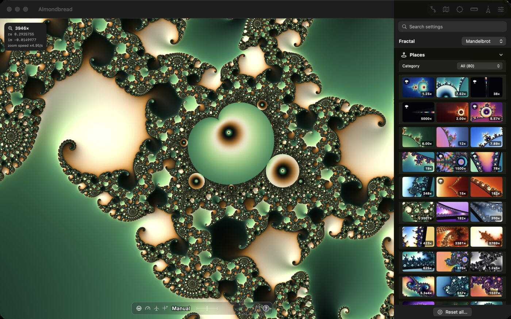
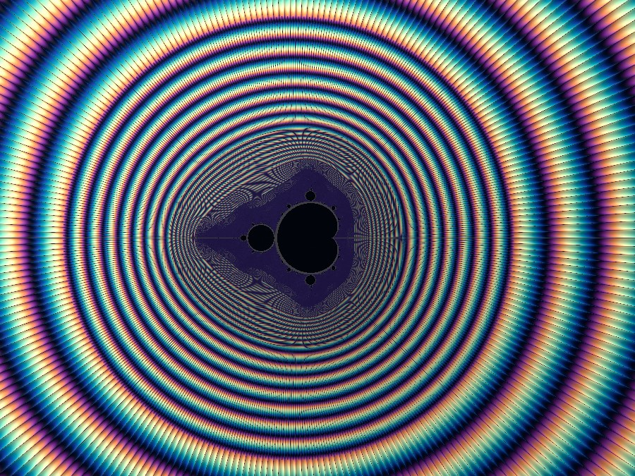
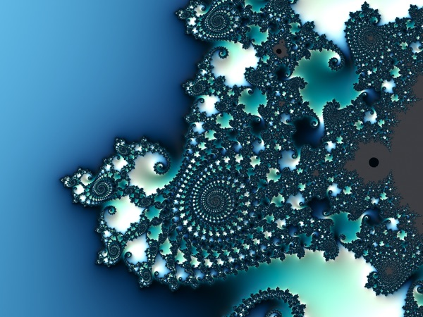

# Almondbread

**Fly into the Mandelbrot set.** Almondbread is a fast, smooth deep-zoom fractal explorer
for Macs with Apple silicon. Zoom with the mouse, the trackpad or the keyboard, and keep
going far past where ordinary explorers turn into blocky noise: down to a zoom of 10^3000,
at the frame rate of your display.



<p align="center">
  
  
  
</p>

## What you can do

- **Zoom without limits.** Arbitrary-precision maths and the GPU work together, so deep views
  stay sharp and arrive quickly.
- **Steer the autopilot.** Press **Z** and the app zooms on by itself; move the pointer to
  steer, or let it look for spirals and minibrots.
- **Take a journey.** **J** flies from landmark to landmark on an endless planned route.
  Every journey has a number you can share, and there is a journey of the day.
- **Visit famous places.** A catalogue of well-known spots (seahorse valley, the elephants,
  embedded Julia sets, minibrots at 10^1000, places down to 10^3000) with thumbnails, one click away.
- **Colour it your way.** Dozens of palettes, from classic gradients to scientific colour
  maps, several interior colourings, and imports of Ultra Fractal and Fractint palettes.
- **Find π.** Turn on the π meter at the neck of the set and watch the iteration count spell
  out 3.14159...
- **See how deep you are.** A mini-map of the whole set and a scale that compares your view
  with real things, from galaxies to the Planck length.

## Install

You need a Mac with Apple silicon (M1 or later) and macOS 14 Sonoma or newer.

- **Download:** get `almondbread_<version>_aarch64.dmg` from the
  [latest release](https://github.com/ractive/almondbread/releases/latest), open it and drag
  Almondbread to Applications. The app is signed and notarised by Apple.
- **Homebrew:**

  ```sh
  brew install --cask ractive/tap/almondbread
  ```

## Controls

| | |
|---|---|
| Move the mouse | zoom happens where the pointer is |
| Hold **Space** / **Shift-Space** | zoom in / out |
| Scroll, pinch, **+** / **-** | zoom; two-finger drag or **W A S D** pans |
| Double-click / Option-double-click | zoom in / out there |
| **Q** / **E** | slower / faster zoom |
| **Z** | autopilot (click pauses, **Esc** stops) |
| **J** | journey from landmark to landmark |
| **M**, **O**, **P** | mini-map, orbit of the point under the pointer, π meter |
| **,** **.** **/** | turn the view, straighten it |
| **R** or **Cmd-0** | back to the whole set |
| **Cmd-I** | control center with every setting, the places and the palettes |

The control center lists every shortcut under *Controls*.

## Build from source

Requirements: macOS on Apple silicon, Xcode 26, [Rust](https://rustup.rs) (stable) and
[XcodeGen](https://github.com/yonaskolb/XcodeGen) (`brew install xcodegen`).

```sh
git clone https://github.com/ractive/almondbread.git
cd almondbread
make run        # build the Rust core and start the app (swift run)
make app        # or build Almondbread.app with Xcode
make dmg        # or package it as a .dmg in dist/
```

`make rust-check` runs the Rust tests and lints. There is also a command-line tool for
rendering stills: `make render ARGS="--center -0.7436,0.1318 --scale 1e-8"`.

Curious how it works? The [`kb/`](kb/) folder is a wiki of the maths and engineering behind
the app: perturbation theory, approximations, colouring, benchmarks and decisions.

## Contributing

Bug reports, ideas and pull requests are welcome. See [CONTRIBUTING.md](CONTRIBUTING.md).

## Licence

MIT, see [LICENSE](LICENSE). Third-party material (the Inter font, colour maps) is listed in
[THIRD_PARTY_NOTICES.md](THIRD_PARTY_NOTICES.md).

Much of this code was written by AI systems under human supervision; see
[AI_NOTICE](AI_NOTICE).
